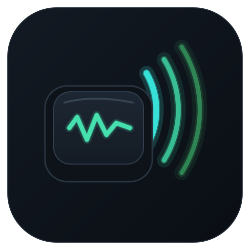
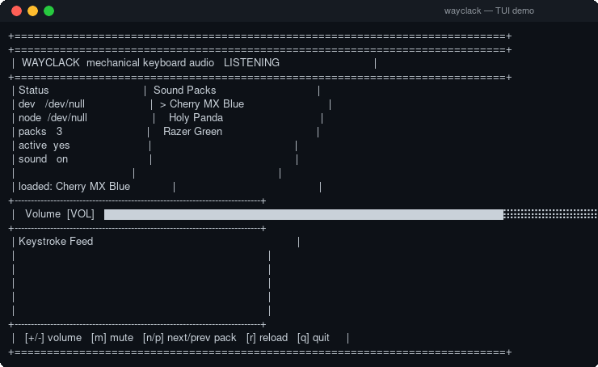

<div align="center">



# WayClack

**A lightweight, Linux-native mechanical keyboard sound emulator for Wayland.**

WayClack listens directly to raw kernel input events (`evdev`) and plays
low-latency mechanical switch samples on every keystroke — with a fast,
dependency-free terminal UI.

[](LICENSE)
[](https://isocpp.org/)
[](#requirements)
[](https://github.com/ghb-n/wayclack/releases)
[](https://github.com/hainguyents13/mechvibes)



</div>

---

## Features

- **Interactive TUI** — a responsive terminal dashboard with a live volume bar,
  mute toggle, sound-pack switcher, keystroke feed, and status panel. Written in
  plain C++ (ANSI escapes + raw `termios`) with **no extra dependencies**.
- **Low-latency input capture** — reads the Linux input subsystem
  (`/dev/input/event*`) directly on a background thread, bypassing display-server
  restrictions entirely. Works on Wayland and X11.
- **Smart device autodetection** — scores every input node and picks the best
  keyboard. It finds **built-in laptop keyboards** (`i8042`/`serio`, e.g.
  *"AT Translated Set 2 keyboard"*) as well as USB boards, down-ranks mice that
  expose a HID keyboard interface, and rejects button/media-only nodes. Prefers
  stable `/dev/input/by-id` / `by-path` links when available.
- **Sound-pack autodetection** — scans a directory for MechVibes-style packs and
  loads them live by directory listing.
- **Efficient audio** — samples are decoded once and cached per pack (no disk
  reads per keystroke); volume and mute apply instantly.
- **Clean architecture** — modern C++17 with RAII, encapsulated subsystems, and a
  clear separation between input, audio, parsing, discovery, and UI.

## Requirements

- Linux (Wayland or X11)
- A C++17 compiler (GCC or Clang)
- **SDL2** and **SDL2_mixer** — `sudo apt install libsdl2-dev libsdl2-mixer-dev`
- **nlohmann/json** — `sudo apt install nlohmann-json3-dev`
- CMake ≥ 3.14
- Membership in the `input` group (see [Permissions](#permissions))

## Build

```sh
git clone --recurse-submodules https://github.com/ghb-n/wayclack.git
cd wayclack
cmake -S . -B build
cmake --build build -j
```

The binary is produced at `build/wayclack`.

## Usage

```sh
wayclack [options]
```

| Option | Description |
| --- | --- |
| `-p, --packs <dir>` | Directory containing sound packs (default: `~/mechvibes_custom`) |
| `-d, --device <path>` | evdev device, e.g. `/dev/input/event0` (default: autodetect) |
| `-l, --list-devices` | List detected keyboard-like devices and exit |
| `-m, --mute` | Start muted |
| `-v, --version` | Show version and exit |
| `-h, --help` | Show help |

### TUI controls

| Key | Action |
| --- | --- |
| `+` / `-` | Volume up / down |
| `m` | Mute / unmute |
| `n` / `p` | Next / previous sound pack |
| `r` | Reload the current pack from disk |
| `q` | Quit |

### Finding your keyboard

If autodetection picks the wrong device (or finds nothing), list the candidates:

```sh
wayclack --list-devices
```

```
score 187  /dev/input/event0
           name: AT Translated Set 2 keyboard
           link: /dev/input/by-path/platform-i8042-serio-0-event-kbd
score 52   /dev/input/event15
           name: USB OPTICAL MOUSE  Keyboard
           link: /dev/input/by-id/usb-18f8_USB_OPTICAL_MOUSE-if01-event-kbd
```

Then pin the right one with `--device`:

```sh
wayclack --device /dev/input/event0
```

## Sound packs

WayClack reads [MechVibes](https://github.com/hainguyents13/mechvibes)
`.json` configs. Each pack is a directory containing a `config.json` and its
audio samples:

```
~/mechvibes_custom/
├── Razer Green/
│   ├── config.json
│   ├── key1.wav
│   └── space.wav
└── Cherry MX Blue/
    ├── config.json
    └── click.wav
```

A minimal `config.json`:

```json
{
  "id": "custom-sound-pack-1",
  "name": "Razer Green",
  "sound": "key1.wav",
  "volume": "100",
  "defines": {
    "30": "key1.wav",
    "31": "key2.wav",
    "57": "space.wav"
  }
}
```

`defines` maps **Linux key codes** (see `linux/input-event-codes.h`) to sample
files, relative to the pack directory.

## Permissions

Reading a keyboard device requires access to `/dev/input/event*`. Add your user
to the `input` group and re-login:

```sh
sudo usermod -aG input "$USER"
```

Verify with `groups` (you should see `input`). Running as root also works but is
not recommended.

## Troubleshooting

| Symptom | Fix |
| --- | --- |
| `cannot open /dev/input/...` | Add yourself to the `input` group (above) and re-login. |
| Wrong keyboard detected | Run `--list-devices` and pass the correct `--device`. |
| No packs found | Check `--packs <dir>`; each pack needs a `config.json`. |
| No sound | Confirm SDL2_mixer is installed and the pack's `.wav` files exist. |
| UI looks garbled | Use a modern terminal with UTF-8 and a monospace font. |

## Project layout

```
src/
├── mainwindow.cpp          # entry point, CLI argument parsing
├── cli/                    # TUI (rendering, input, layout)
├── keyboard/               # threaded evdev listener + key-name mapping
├── audio_driver/           # SDL_mixer wrapper with per-pack sample cache
├── parser/                 # MechVibes JSON config parsing
└── discovery/              # sound-pack + keyboard-device autodetection
docs/
├── logo.svg / logo.png     # project logo
├── demo.gif                # demo recording
└── demo/                   # vhs tape + GIF render script + sample packs
```

## Contributing

Issues and pull requests are welcome. Please keep changes consistent with the
existing style (C++17, RAII, small focused modules) and make sure the project
builds warning-free before opening a PR.

## License

Released under the [MIT License](LICENSE).

Inspired by [MechVibes](https://github.com/hainguyents13/mechvibes) — this
project is an independent, Linux-native reimplementation.
